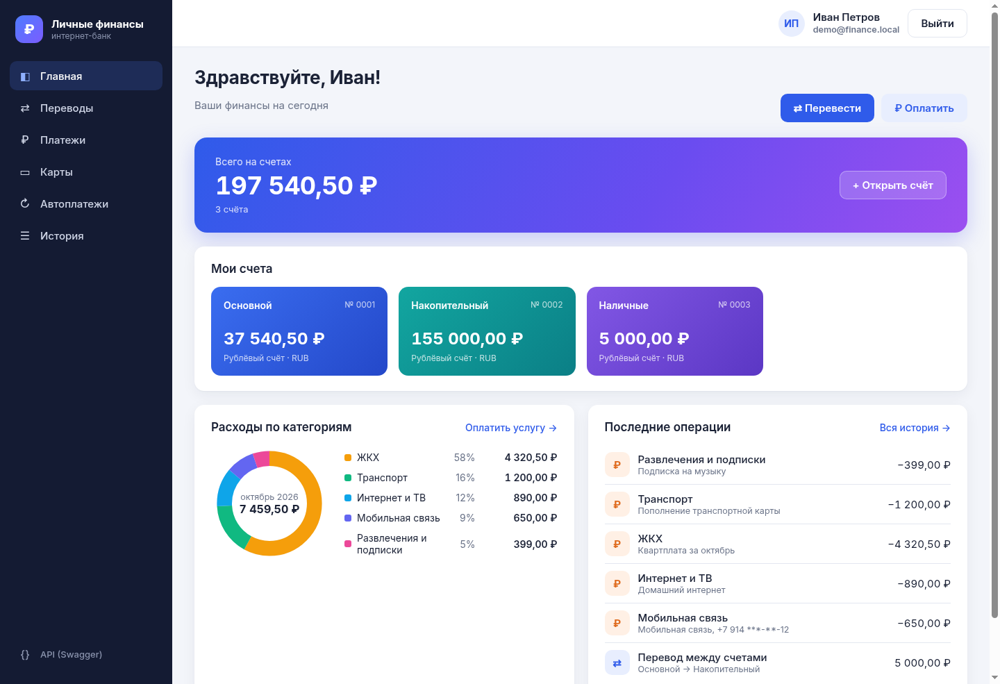

# Личные финансы
Проект по автоматизированному тестированию.



## Что умеет

- регистрация и вход, роли клиента и администратора
- счета, переводы между своими счетами, история операций
- карты, оплата услуг, автоплатежи
- в админке можно смотреть пользователей и блокировать их

## Стек

Бэкенд: Java 17, Spring Boot, Spring Security с JWT, H2, Flyway.
Фронтенд: React, TypeScript, Vite.
Автотесты: JUnit 5, RestAssured, Selenide, Allure.

## Что где лежит

- `backend` — сервер
- `frontend` — интерфейс
- `autotests` — API и UI автотесты
- `qa` — тест-план, тест-кейсы, чек-лист и баг-репорты

## Как запустить

Бэкенд:

```bash
cd backend
mvn spring-boot:run
```

Фронтенд, в соседнем терминале:

```bash
npm --prefix frontend install
npm --prefix frontend run dev
```

Приложение открывается на http://localhost:5173, Swagger на http://localhost:3000/api/docs.

Тестовые пользователи:
- клиент: `demo@finance.local` / `demo12345`
- админ: `admin@finance.local` / `admin12345`

Ещё можно запустить всё через Docker: `docker compose up --build`, потом открыть http://localhost:8080.

## Тесты

Тесты бэкенда:

```bash
cd backend
mvn test
```

Для автотестов бэкенд нужно запустить с тестовым профилем:

```bash
cd backend
mvn spring-boot:run -Dspring-boot.run.profiles=test
```

Потом запустить фронтенд и сами тесты:

```bash
cd autotests
mvn clean test
mvn allure:serve
```

Можно запускать отдельные группы, например `mvn clean test -Dgroups=api` или `-Dgroups=ui`.
