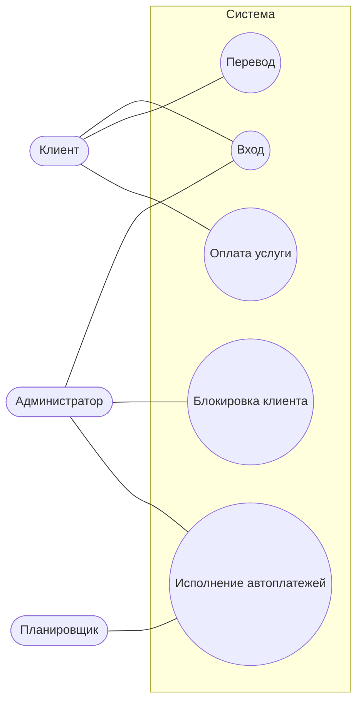

# Сценарии использования

| ID | Название | Кто участвует |
|---|---|---|
| UC-01 | Перевод между своими счетами | Клиент |
| UC-02 | Вход | Клиент, администратор |
| UC-03 | Оплата услуги | Клиент |
| UC-04 | Исполнение автоплатежей | Планировщик, администратор |
| UC-05 | Блокировка клиента | Администратор |

## UC-01. Перевод между своими счетами

Предусловие: клиент вошёл, у него минимум два счёта.

Основной сценарий:
1. Клиент выбирает, откуда и куда перевести, вводит сумму и нажимает «Перевести».
2. Фронтенд отправляет `POST /api/transfers` с токеном.
3. Система проверяет токен, сумму и что счета разные.
4. Система блокирует оба счёта в базе и проверяет, что они существуют и принадлежат клиенту.
5. Система проверяет остаток и дневной лимит.
6. Система списывает и зачисляет деньги и записывает операцию в одной транзакции.
7. Клиент видит уведомление, остатки обновляются.

Ошибки:
- не выбран счёт — запрос не отправляется;
- нет токена или он недействителен — 401, клиента отправляет на вход;
- некорректная сумма — 400 `INVALID_AMOUNT`;
- счёт тот же — 422 `SAME_ACCOUNT`;
- счёт не найден или чужой — 404 `ACCOUNT_NOT_FOUND`;
- не хватает денег — 422 `INSUFFICIENT_FUNDS`;
- превышен лимит — 422 `DAILY_LIMIT_EXCEEDED`.

При любой ошибке остатки не меняются. Схема процесса — в [04-bpmn-transfer.md](04-bpmn-transfer.md).

## UC-02. Вход

1. Пользователь открывает страницу. Если он не вошёл, его отправляет на /login.
2. Вводит email и пароль, фронтенд отправляет `POST /api/auth/login`.
3. Система проверяет пароль и что пользователь не заблокирован, выдаёт JWT на 24 часа.
4. Клиент попадает туда, куда хотел, администратор — в админку.
5. Дальше каждый запрос идёт с токеном. Сервер на каждом запросе загружает пользователя из базы, поэтому блокировка срабатывает сразу.

Ошибки: неверный email или пароль — 401 `INVALID_CREDENTIALS`, пользователь заблокирован — 403 `USER_BLOCKED`, клиент лезет в `/api/admin` — 403 `FORBIDDEN`.

## UC-03. Оплата услуги

1. Клиент открывает «Платежи», выбирает категорию, счёт или карту, вводит сумму и нажимает «Оплатить».
2. Фронтенд отправляет `POST /api/payments`.
3. Система проверяет категорию, что выбран ровно один источник, и сумму.
4. Если платят картой, система проверяет, что карта своя, не заблокирована и не просрочена. Деньги списываются со счёта карты.
5. Система проверяет остаток, списывает деньги и записывает операцию с категорией. Дневной лимит переводов не тратится.

Ошибки: нет источника или выбраны оба — 400, нет категории — 404 `CATEGORY_NOT_FOUND`, чужая карта — 404 `CARD_NOT_FOUND`, карта заблокирована или просрочена — 422, не хватает денег — 422 `INSUFFICIENT_FUNDS`.

## UC-04. Исполнение автоплатежей

Запускается планировщиком раз в минуту или администратором кнопкой «Выполнить автоплатежи».

1. Система выбирает активные автоплатежи, у которых дата списания сегодня или раньше.
2. Каждый проводится в отдельной транзакции, чтобы ошибка одного не мешала остальным.
3. Система проверяет, что владелец не заблокирован, и проводит оплату как в UC-03.
4. Статус SUCCESS или FAILED с причиной, дата переносится на следующий период.
5. Возвращается итог: сколько обработано, сколько успешно и сколько с ошибкой.

Если сервер был выключен несколько периодов, пропущенные списания не догоняются. Схема — в [08-bpmn-autopayment.md](08-bpmn-autopayment.md).

## UC-05. Блокировка клиента

1. Администратор находит клиента в списке и нажимает «Заблокировать».
2. Фронтенд отправляет `POST /api/admin/users/{id}/block`.
3. Система проверяет роль вызывающего и что блокируют не администратора.
4. Клиент помечается заблокированным. Его следующий запрос получает 403 `USER_BLOCKED`, и его выкидывает на страницу входа.

Ошибки: пользователь не найден — 404, попытка заблокировать администратора — 422 `CANNOT_BLOCK_ADMIN`. Разблокировка работает так же через `/unblock`.
