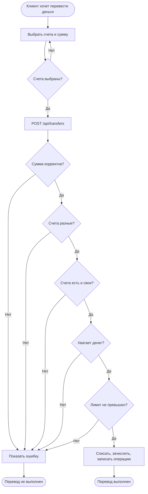

# BPMN: перевод между счетами

Схема лежит в [04-bpmn-transfer.bpmn](04-bpmn-transfer.bpmn), её можно открыть в Camunda Modeler или на demo.bpmn.io. Ниже та же логика упрощённо.

Перед переводом сервер проверяет токен и что пользователь не заблокирован. Всё от проверки счетов до записи операции идёт в одной транзакции, при ошибке она откатывается.
