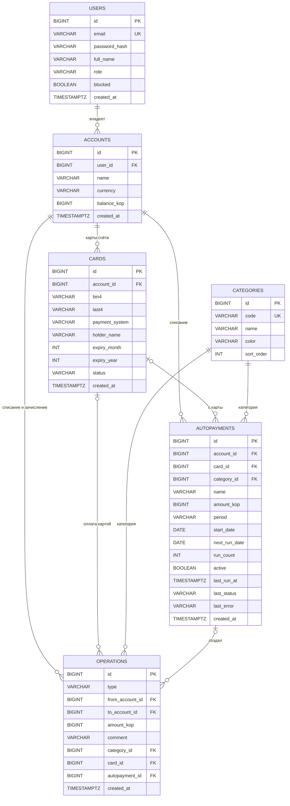

# Модель данных

Схему создают миграции Flyway: `V1__init.sql`, `V2__users_cards_payments.sql` и Java-миграция `V3__Allow_payment_operations`. Hibernate схему не меняет, только сверяет с сущностями. База H2: файл `backend/data/finance.mv.db`, в тестовом профиле — в памяти.

## Таблицы

- `users` — пользователи. Email хранится в нижнем регистре, пароль только как BCrypt-хеш. Роль CLIENT или ADMIN.
- `accounts` — счета. Остаток в копейках, в базе стоит проверка, что он не меньше 0.
- `cards` — карты. Хранятся только первые и последние 4 цифры номера, маска собирается при выдаче: `2200 **** **** 1234`. Статус ACTIVE или BLOCKED.
- `categories` — 8 категорий оплаты, заводятся миграцией V2: связь, интернет, ЖКХ, транспорт, образование, развлечения, здоровье и прочее.
- `operations` — журнал операций. Тип OPENING, TRANSFER или PAYMENT. У пополнения нет счёта списания, у платежа нет счёта зачисления.
- `autopayments` — автоплатежи. Период DAILY, WEEKLY или MONTHLY, дата следующего списания и результат последнего запуска.

## Решения

- Деньги хранятся в копейках как целые числа, чтобы не было ошибок округления. API принимает и отдаёт рубли.
- Владелец указан только у счёта. Карты, операции и автоплатежи принадлежат клиенту через счёт.
- При переводе и оплате строки счетов блокируются через `SELECT ... FOR UPDATE`, всегда в порядке возрастания id, чтобы не было дедлоков.
- Текущее время берётся из бина `Clock`, поэтому в тестах его можно сдвигать.
