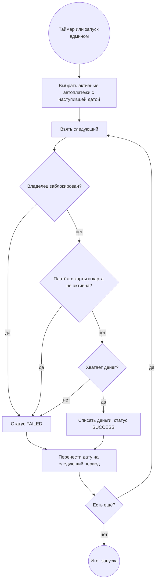

# BPMN: исполнение автоплатежей

Процесс запускает планировщик раз в минуту или администратор вручную через `POST /api/admin/autopayments/run`. Схема лежит в [08-bpmn-autopayment.bpmn](08-bpmn-autopayment.bpmn).

Каждый автоплатёж проводится в своей транзакции, поэтому ошибка одного не влияет на остальные. Следующая дата считается от даты первого списания, так что платёж 31-го числа не съезжает. В тестовом профиле планировщик выключен, а время на сервере можно сдвигать через `POST /api/test/clock`.
